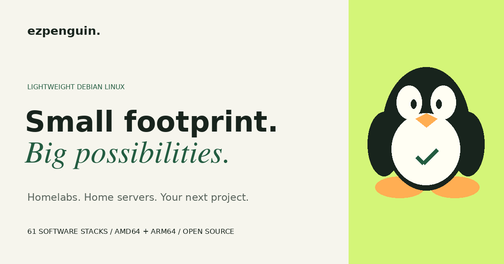

# EZpenguin — lightweight Debian Linux

**Small footprint. Big possibilities.**

A minimal Debian-based Linux OS for homelabs, home servers, and self-hosted projects.
Start small, choose your software, and keep control of your machine.

[**Website**](https://zarigata.github.io/EZpenguin/) · [**Download**](https://github.com/zarigata/EZpenguin/releases) · [**Installation guide**](docs/INSTALLATION.md) · [**Star on GitHub**](https://github.com/zarigata/EZpenguin)

## What is EZpenguin?

EZpenguin builds on **Debian 12 (bookworm)** with an automated first-boot wizard,
a **61-entry software catalog**, and auditable Bash tools for everyday server tasks.
Use it as a starting point for a container host, development box, file server,
network lab, or optional lightweight desktop.

| Feature | What you get |
|---|---|
| Minimal base | Terminal-focused Debian system; install the software you need |
| Software selection | 61 install recipes across servers, development, networking, security, tools, and desktops |
| First-boot setup | Interactive wizard or unattended configuration with optional SSH |
| amd64 images | Flashable disk image and live ISO targeting BIOS and UEFI |
| ARM64 images | Rootfs and disk image targeting compatible UEFI ARM64 systems |
| Online installer | Container conversion or target-disk installation from a running Linux environment |
| Local administration | Configuration, diagnostics, backups, and updates through `ez-*` tools |
| Build it yourself | Versioned Docker-based build scripts and rootfs / QEMU test suites |

**Project status:** v0.4.1 is an early-stage release. Wider real-hardware testing,
artifact signing, and further hardening remain on the [roadmap](docs/ROADMAP.md).
ARM64 support does not imply compatibility with every single-board computer.
Docker makes the build process consistent; bit-for-bit identical artifacts are
not currently guaranteed.

## Get started

### 1. Pick an image

Download from [GitHub Releases](https://github.com/zarigata/EZpenguin/releases).
These are the published **v0.4.1** artifacts (sizes rounded, decimal MB):

| Artifact | Size | Use |
|---|---:|---|
| [amd64 disk image](https://github.com/zarigata/EZpenguin/releases/download/v0.4.1/ezpenguin-0.4.1-amd64.img.xz) | 317 MB | Flash to a dedicated drive or use in a VM |
| [amd64 live ISO](https://github.com/zarigata/EZpenguin/releases/download/v0.4.1/ezpenguin-0.4.1-amd64.iso) | 260 MB | Boot a live environment and optionally install to disk |
| [amd64 rootfs](https://github.com/zarigata/EZpenguin/releases/download/v0.4.1/ezpenguin-0.4.1-amd64-rootfs.tar.xz) | 169 MB | Online installer or custom image workflows |
| [ARM64 disk image](https://github.com/zarigata/EZpenguin/releases/download/v0.4.1/ezpenguin-0.4.1-arm64.img.xz) | 285 MB | Compatible UEFI ARM64 hardware / VMs |
| [ARM64 rootfs](https://github.com/zarigata/EZpenguin/releases/download/v0.4.1/ezpenguin-0.4.1-arm64-rootfs.tar.xz) | 152 MB | ARM64 installer / custom image workflows |

### 2. Boot in a VM or spare machine

For a first look, attach the **amd64 ISO to a VM**. For a dedicated machine,
write the matching disk image to its drive, then boot it. Follow the wizard
to set your locale, timezone, hostname, user, and optional SSH access.

**Flashing and disk installation erase the selected drive.** Back up your data
and check the target carefully. See the [installation guide](docs/INSTALLATION.md)
for each method, headless setup, and environment limitations.

### 3. Choose your software

~~~bash
ez-software list
ez-software search docker
sudo ez-software install docker python java nodejs
sudo ez-software
~~~

The catalog installs packages and may enable services through post-install hooks.
Most entries use Debian packages; some use upstream installers. Entries are recipes,
not bundled or independently certified application stacks.

## Online installer

Download and review the script before running it as root:

~~~bash
curl -fsSL https://raw.githubusercontent.com/zarigata/EZpenguin/main/installer/online-installer.sh -o ezpenguin-install.sh
less ezpenguin-install.sh
sudo bash ezpenguin-install.sh
~~~

- **Containers:** replaces the running userland in place. A normal Docker container
  does not boot systemd or run the first-boot wizard just because it is restarted.
- **Regular machines, including VMs:** asks for a target disk and erases it before
  installation. In-place conversion outside a detected container requires the
  explicit `EZP_INPLACE=1` override and is an advanced, destructive workflow.
- The installer downloads a rootfs from the latest release and may reboot the machine
  or stop the container. It requires `curl`, `tar`, and `xz`.

Use a disposable environment when evaluating conversion. Full details:
[online installation](docs/INSTALLATION.md#online-installer).

## Software catalog (61 stacks)

[**Search the catalog on the website →**](https://zarigata.github.io/EZpenguin/#software)

| Category | Entries | Examples |
|---|---:|---|
| Servers | 18 | nginx, Caddy, PostgreSQL, MariaDB, Docker, Podman, Samba, Cockpit, Syncthing, Mosquitto |
| Development | 11 | Python + venv, pipx, Node.js, Java, Go, Rust, PHP, Ruby, build-essential |
| Network | 7 | WireGuard tools, OpenVPN, Tailscale, Mosh, Nmap, tshark, tcpdump |
| Security | 6 | Fail2ban, UFW, auditd, ClamAV, rkhunter, unattended-upgrades |
| Tools | 17 | btop, htop, tmux, ncdu, Git, rsync, iperf3, SMART and NVMe tools |
| Desktops | 2 | XFCE, LXDE |

The source of truth is [`config/software-catalog.list`](config/software-catalog.list).
Package versions and availability follow the configured repositories. For example,
the `gitea-light` recipe currently installs **Gogs**, not Gitea.

## Headless first boot

Place a `firstboot.conf` in `/boot/` on the flashed root filesystem:

~~~ini
EZ_LOCALE=en_US.UTF-8
EZ_TIMEZONE=America/Sao_Paulo
EZ_KEYMAP=us
EZ_HOSTNAME=homelab
EZ_USERNAME=penguin
EZ_PASSWORD=replace-with-a-unique-password
EZ_SSH_ENABLE=1
EZ_UPGRADE=1
EZ_REBOOT=1
~~~

Choose a unique password and protect the configuration file. The wizard retains an
applied configuration file, which may contain the password; remove it after setup.
For accepted characters and optional shared user/root password behavior, read the
[headless setup guide](docs/INSTALLATION.md#headless-setup).

## Tools included

| Command | Purpose |
|---|---|
| `ez-firstboot` | Initial setup wizard |
| `ez-install` | Install the live system to a disk |
| `ez-software` | Browse and install software recipes |
| `ez-config` | System settings |
| `ez-backup` | Backup / restore tooling |
| `ez-doctor` | System health checks |
| `ez-net` | Network diagnostics |
| `ez-info` | System overview |
| `ez-update` | Package updates |

## Build and test

Docker, an internet connection, roughly 5 GB free disk, and 2 GB+ RAM are the
documented starting requirements. Build tools use privileged container operations.

~~~bash
git clone https://github.com/zarigata/EZpenguin.git
cd EZpenguin
./build/build.sh all     # full amd64 build + test pipeline
./build/build.sh arm64   # ARM64 cross-build pipeline
~~~

Outputs go in `artifacts/`. The pipeline includes rootfs checks, QEMU BIOS / UEFI
boot checks, ISO boot checks, and wizard tests. The committed
[test report](artifacts/test-report.txt) is a historical result, not a guarantee
that the current checkout was rebuilt or every physical machine is supported.
See [BUILDING](docs/BUILDING.md) and [TESTING](docs/TESTING.md).

## Documentation

| Guide | Covers |
|---|---|
| [Installation](docs/INSTALLATION.md) | Images, live ISO, online installer, VMs, headless setup |
| [Building](docs/BUILDING.md) | Build stages and ARM64 cross-builds |
| [Architecture](docs/ARCHITECTURE.md) | OS layers, boot flow, image layout |
| [Testing](docs/TESTING.md) | Checks, boot tests, and local verification |
| [Quality](docs/QUALITY.md) | Release targets and quality goals |
| [Roadmap](docs/ROADMAP.md) | Completed work and next milestones |
| [Security](docs/SECURITY.md) | Security defaults and reporting |
| [Contributing](docs/CONTRIBUTING.md) | Changes, recipes, and bug reports |
| [Changelog](docs/CHANGELOG.md) | Release history |
| [Website & discoverability](docs/WEBSITE.md) | Site maintenance, deployment, and search setup |

## Help this penguin grow

If EZpenguin is useful to you, [**star the repository**](https://github.com/zarigata/EZpenguin)
to bookmark it and help others discover it. Real hardware reports are especially
valuable: share the machine model, architecture, image version, boot mode, and
what worked or failed in an [issue](https://github.com/zarigata/EZpenguin/issues).

You can also improve an install recipe, clarify a guide, or
[contribute a fix](docs/CONTRIBUTING.md). Please use the actual project experience
when recommending it.

## License

EZpenguin code is **GPL-3.0-or-later**; see [LICENSE](LICENSE).
Individual packages retain their upstream licenses. EZpenguin is independently
maintained and is not affiliated with or endorsed by the Debian Project.
